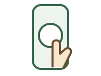
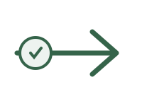
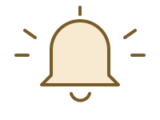
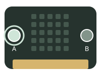
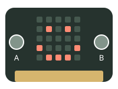
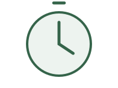
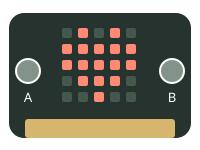

# Lesson 1: Inputs, events and sequence

## Learning intention & success criteria

<div class="learning-objectives" markdown="1">
<section class="learning-intention" markdown="1">

### Learning intention

We are learning to use **inputs, events and sequence** to control a micro:bit.

</section>
<section class="success-criteria" markdown="1">

### Success criteria

- I can identify an **input** and an **output**.
- I can explain what **starts** a button event.
- I can put instructions in the correct **order**.

</section>
</div>

## Input, event and output

**A doorbell helps us understand three computing words.**

<div class="visual-steps" markdown="1">
<section class="visual-step" markdown="1">



### Input

<div class="term-definition" markdown="1">

Information going **into** a system.

</div>
<div class="term-explanation" markdown="1">

You **press the button**. The doorbell detects your press.

</div>

</section>
<section class="visual-step" markdown="1">



### Event

<div class="term-definition" markdown="1">

Something that **starts** instructions.

</div>
<div class="term-explanation" markdown="1">

The button **is pressed**. This starts the bell ringing.

</div>

</section>
<section class="visual-step" markdown="1">



### Output

<div class="term-definition" markdown="1">

Information coming **out of** a system.

</div>
<div class="term-explanation" markdown="1">

The bell makes a **sound**. You hear that someone is at the door.

</div>

</section>
</div>

### Can the press be both an input and an event?

**Yes — it is the same button press.**

- **Input** tells us what information goes in: the button has been pressed.
- **Event** tells us what starts the instructions: the button press happens.

The **sound** is the output produced in response.

## Inputs and outputs

A micro:bit can respond to a button press too.

<div class="visual-steps two-steps" markdown="1">
<section class="visual-step" markdown="1">



### Input: press A

Information goes **into** the micro:bit.

- You press **button A**.
- The board detects the press.

</section>
<section class="visual-step" markdown="1">



### Output: show a face

Information comes **out of** the micro:bit.

- The board lights its **LEDs**.
- You see a happy face.

</section>
</div>

**Remember:** input goes **in**; output comes **out**.

## An event starts instructions

An **event** is something happening, such as pressing a button.

In this example, pressing **button A** starts these **three instructions**:

<div class="event-instructions" markdown="1">

### On button A pressed

1. **Show a happy face.**
2. **Pause for half a second.**
3. **Show a heart.**

</div>

The three instructions sit **inside** the **on button A pressed** event block in MakeCode.

- **Before you press A:** the face–pause–heart sequence has not started.
- **When you press A:** the board runs those three instructions, from **1 to 3**.
- **Press A again:** the same face–pause–heart sequence starts again.

### What about button B?

Button B has its **own event block**: **on button B pressed**.

For example, put **show a sad face** inside that block. Pressing **B** then shows a sad face; it does not start A’s face–pause–heart sequence.

## Sequence: the order matters

**Sequence** means the order in which instructions run.

After you press A, these instructions run from **1 to 3**.

<div class="visual-steps" markdown="1">
<section class="visual-step" markdown="1">


### 1. Show a face

The first image appears.

</section>
<section class="visual-step" markdown="1">



### 2. Pause

Keep the face visible for **half a second**.

</section>
<section class="visual-step" markdown="1">



### 3. Show a heart

The heart **replaces** the face.

</section>
</div>

- **500 milliseconds (ms)** is half a second.
- The **pause** gives you time to see the face.
- Swap the two image blocks and the **heart appears first**.

## Example explained

This example shows the **order of the blocks**. Build it in MakeCode using blocks.

<div class="example-layout" markdown="1">
<div markdown="1">

### Example structure

```text
on button A pressed:
    show happy face
    pause 500 ms
    show heart
```

</div>
<div class="code-reading" markdown="1">

### Reading the instructions

**on button A pressed**

Starts the instructions inside this event when A is pressed.

**show happy face**

Lights the LEDs to display the first image.

**pause 500 ms**

Waits half a second before the next instruction in this sequence.

**show heart**

Replaces the face with a heart; it does not add a second display.

</div>
</div>

### What should happen?

1. **Press A:** the happy face appears.
2. **Wait half a second:** the face stays on the display.
3. **See the heart:** it replaces the face and stays on the display.

## What to remember

<dl class="recap-list">
<div><dt>Input</dt><dd>Information goes in: you press button A.</dd></div>
<div><dt>Event</dt><dd>Something happens: the press starts the instructions.</dd></div>
<div><dt>Sequence</dt><dd>Instructions run in order: face, pause, heart.</dd></div>
<div><dt>Output</dt><dd>Information comes out: an image appears on the LEDs.</dd></div>
</dl>

## Your workbook tasks

### 1. Open your workbook

Open the [pupil workbook](https://docs.google.com/document/d/1TtgnkWvogK3TJ2bSEFirT5LDdON6QLlhlYuBmnWRdAc/edit?usp=drivesdk){ target="_blank" rel="noopener noreferrer" } and find **Lesson 1**.

### 2. Complete Tasks 1.1, 1.2 and 1.3

- Create **button reactions** using images and pauses.
- Put your blocks in the **order** you want them to run.
- Use **button events** for this lesson.

### 3. Add your evidence

- Show your **button event and its blocks**.
- Label one **input** and one **output**.
- Explain **why the order matters**.

### Need help with the blocks?

Use the [Pocket personality guide](../01-pocket-personality.md) for button events and image sequences.
