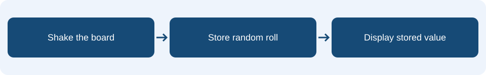

# Lesson 2: Variables and random numbers

## Learning intention & success criteria

**Learning intention:** Store a number in a variable and explain how a random range works.

By the end of this lesson, you should be able to:

- Explain the difference between setting and reading a variable.
- Identify every possible value in a random range.
- Trace the saved value through a shake and two button presses.

Read one page at a time. Predict before checking the explanations. Your practical tasks are in your workbook.

## The idea in everyday life

Imagine a scoreboard with the label score above a number. The label stays the same while the number changes. A variable works in a similar way: it gives a stored value a name so the program can use it later.

## A name for a stored value

Create a variable called roll. Setting roll to 4 stores 4 under that name. Setting it to 2 later replaces 4; it does not keep both numbers. A show number roll block reads the value currently stored in roll. Displaying a value does not change it.

<aside class="word-note" markdown="1">
**Key word: Variable**

A name used to store a value.
</aside>

## Choose once, use again

Pick random 1 to 6 chooses a whole number from 1, 2, 3, 4, 5 or 6. Both limits are included. Put that block inside set roll so the chosen result is saved. If you put a fresh random block inside every display block, each display can choose a different number.

<aside class="word-note" markdown="1">
**Key word: Random range**

The allowed values from which a random result is chosen.
</aside>

## Give the program a starting value

Put set roll to 1 in on start. This gives the dice a clear starting value before anyone shakes the board. The shake event replaces it with a random roll. Button A reads the saved roll. Random results can repeat: getting 4 twice does not show that the program is broken.

<aside class="word-note" markdown="1">
**Key word: Initialise**

Give a variable its starting value.
</aside>

## Follow it on the micro:bit



Shaking chooses and stores a new roll. Pressing A displays the stored value without rolling again. Set roll to 1 at startup so A also has a value before the first shake.

## Example explained

This is **pseudocode** describing the MakeCode Blocks. Rebuild it using blocks; it is not code to paste into the editor. Any setup or surrounding events described on the previous pages are also needed.

<div class="example-layout" markdown="1">
<div markdown="1">

### Example structure

```text
on start:
    set roll to 1
on shake:
    set roll to pick random 1 to 6
    show number roll
on button A pressed:
    show number roll
```

</div>
<div class="code-reading" markdown="1">

### Reading the instructions

**on start → set roll to 1**

Gives the saved result a known starting value.

**on shake**

Starts a new roll when the board detects a shake.

**set roll to pick random 1 to 6**

Chooses one allowed number and replaces the saved value.

**show number roll**

Displays the saved value. In the A event this reads it without rolling again.

</div>
</div>

### What should happen?

After startup, A displays 1. Suppose a shake chooses 4: the board shows 4 and roll stores 4. Two A presses both show 4. A later shake may choose a different number, or choose 4 again.

<aside class="word-note" markdown="1">
**Watch out**

Do not use change roll by with a random number for a dice. That adds to the old result and can produce values above 6. Use set roll to replace it.
</aside>

## Predict, trace and check

If roll stores 4, what will two A presses display? Can 0 or 7 be generated by the stated range?

Explain your prediction before trying the program. Follow the event one instruction at a time, keeping track of any stored values.

<details markdown="1">
<summary>Check your reasoning</summary>

Both A presses display 4. Neither 0 nor 7 is inside the inclusive range 1 to 6. Thirty valid rolls check the range but do not prove that every result is equally likely.

</details>

## What to remember

<p class="main-idea">Choose a value, store it, then read that same value when you need it.</p>

### Can you explain it?

- I can explain the difference between setting and reading a variable.
- I can identify every possible value in a random range.
- I can trace the saved value through a shake and two button presses.

Return to the example if you cannot yet explain one of these points. Use the key words to explain what the blocks do, rather than only describing where to click.

## Apply it in your workbook

Build the dice without an if block. Record 30 rolls and check every result is between 1 and 6. Keep this project for Lesson 3.

**Evidence and explanation:** Explain what roll stores and the difference between generating a new value and displaying the stored value.

Complete **Tasks 2.1, 2.2 and 2.3** in the [Google Docs pupil workbook](https://docs.google.com/document/d/1TtgnkWvogK3TJ2bSEFirT5LDdON6QLlhlYuBmnWRdAc/edit?usp=drivesdk){ target="_blank" rel="noopener noreferrer" }. Use the lesson heading to find your tasks.

### Practical references

These guides retain their original project numbers; those numbers are not the new teaching lesson numbers. Use the relevant tasks described below.

- [Dice reference: use the corrected dice in Task 2; investigate its faulty condition in Lesson 3.](../02-unfair-dice.md)

[Back to the teaching sequence](index.md)
