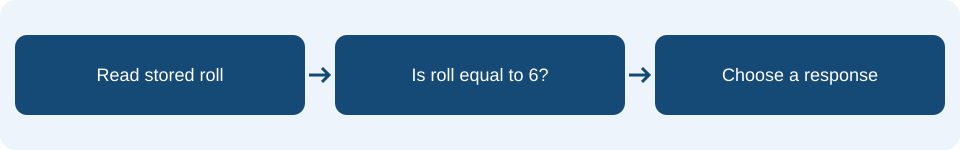

# Lesson 3: Selection and comparisons

**Learning intention:** Use an if condition to choose whether instructions run.

## Understand the concept

Selection makes a decision. A condition is a check with a true or false result. Equality (=) checks whether values match; > and < compare their size.

## Connect it to the micro:bit



Continue with the dice from Lesson 2. Button B checks the stored roll; it does not generate another number. The else branch runs when roll is not 6.

## Read the example

This is **pseudocode** showing the order and structure of the MakeCode Blocks. It is not code to paste into the editor.

```text
on button B pressed:
    if roll = 6:
        show happy face
    else:
        show number roll
```

## Predict and discuss

Trace the event for roll = 6 and roll = 2. Does displaying a face change the value stored in roll?

## Apply it in your workbook

Add a decision to your existing dice. Then inspect the faulty rule that changes every 6 to 1 and explain why it makes the dice unfair.

**Evidence and explanation:** Include your condition, predictions for both outcomes and actual test results.

Complete **Tasks 3.1, 3.2 and 3.3** in the [Google Docs pupil workbook](https://docs.google.com/document/d/1TtgnkWvogK3TJ2bSEFirT5LDdON6QLlhlYuBmnWRdAc/edit?usp=drivesdk){ target="_blank" rel="noopener noreferrer" }. Use the lesson heading to find your tasks.

## Practical references

These guides retain their original project numbers; those numbers are not the new teaching lesson numbers. Use the relevant tasks described below.

- [Faulty dice investigation: trace the if rule in Task 1, then repair it.](../02-unfair-dice.md)

[Back to the teaching sequence](index.md)
