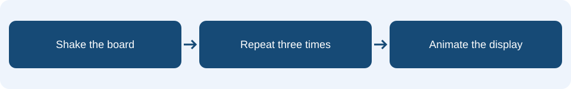

# Lesson 4: Iteration

## Learning intention & success criteria

**Learning intention:** Explain counted repetition and distinguish it from continuous repetition.

By the end of this lesson, you should be able to:

- Count how often an instruction inside a loop runs.
- Identify which instructions belong to the loop body.
- Choose between counted and continuous repetition.

Read one page at a time. Predict before checking the explanations. Your practical tasks are in your workbook.

## The idea in everyday life

A dance routine might say clap, stamp, repeat three times. You do not need to write the same pair of actions three times. A loop lets a program repeat a group of instructions.

## Repeat a known number of times

Iteration means repeating instructions. A repeat 3 times block runs all the instructions inside it, returns to the top, and does that until three complete passes have finished. Instructions after the loop run once the counted repetition ends.

<aside class="word-note" markdown="1">
**Key word: Iteration**

Repeating instructions.
</aside>

## Check what is inside

The loop body contains both images and both pauses. One pass shows a large diamond, waits, shows a small diamond, then waits again. Three passes run six show instructions and six pause instructions. Moving a block outside the loop changes how often it runs.

<aside class="word-note" markdown="1">
**Key word: Loop body**

The group of instructions inside a loop.
</aside>

## Keep checking with forever

A forever block repeats while the program runs. It suits a sensor display because the light level can change at any time. Read light level inside the loop to get a fresh reading each pass. A pause spaces the updates so the display is usable. Use a separate project for this example so two loops do not compete for the display.

<aside class="word-note" markdown="1">
**Key word: Forever**

A loop that continues while the program runs.
</aside>

## Follow it on the micro:bit



Return to the character from Lesson 1 and add the shake animation. Both show blocks and both pauses belong inside the loop. Later, try a separate forever example that repeatedly displays the light level.

## Example explained

This is **pseudocode** describing the MakeCode Blocks. Rebuild it using blocks; it is not code to paste into the editor. Any setup or surrounding events described on the previous pages are also needed.

<div class="example-layout" markdown="1">
<div markdown="1">

### Example structure

```text
on shake:
    repeat 3 times:
        show diamond
        pause 200 ms
        show small diamond
        pause 200 ms
```

</div>
<div class="code-reading" markdown="1">

### Reading the instructions

**on shake**

Starts one counted animation.

**repeat 3 times**

Repeats the whole enclosed sequence three times.

**show diamond → pause 200 ms**

Shows the large frame for one fifth of a second.

**show small diamond → pause 200 ms**

Shows the small frame before the next pass starts.

</div>
</div>

### What should happen?

One shake produces three large-to-small animation cycles. The pauses total 1,200 ms across the three cycles, plus any time used by other blocks. After the last pause, the small diamond remains.

<aside class="word-note" markdown="1">
**Watch out**

A forever loop does not stop after three passes. Choose repeat when an animation must finish, and forever when a program must keep checking or updating.
</aside>

## Predict, trace and check

How many image instructions run after one shake? How is repeat 3 different from forever?

Explain your prediction before trying the program. Follow the event one instruction at a time, keeping track of any stored values.

<details markdown="1">
<summary>Check your reasoning</summary>

Six image instructions run: two in each of three passes. Repeat 3 finishes; forever keeps repeating until the program stops or restarts.

</details>

## What to remember

<p class="main-idea">The loop repeats everything inside it, in order.</p>

### Can you explain it?

- I can count how often an instruction inside a loop runs.
- I can identify which instructions belong to the loop body.
- I can choose between counted and continuous repetition.

Return to the example if you cannot yet explain one of these points. Use the key words to explain what the blocks do, rather than only describing where to click.

## Apply it in your workbook

Add and test the counted animation. In a separate example, use forever to show the light level, pause 500 ms, then repeat automatically as you cover and uncover the display.

**Evidence and explanation:** Show both loop structures and explain when each is useful.

Complete **Tasks 4.1, 4.2 and 4.3** in the [Google Docs pupil workbook](https://docs.google.com/document/d/1TtgnkWvogK3TJ2bSEFirT5LDdON6QLlhlYuBmnWRdAc/edit?usp=drivesdk){ target="_blank" rel="noopener noreferrer" }. Use the lesson heading to find your tasks.

### Practical references

These guides retain their original project numbers; those numbers are not the new teaching lesson numbers. Use the relevant tasks described below.

- [Character reference: reopen the button project, then add the shake loop shown on this teaching page.](../01-pocket-personality.md)
- [Light measurement reference: the alarm is developed in Lesson 5.](../04-treasure-alarm.md)

[Back to the teaching sequence](index.md)
