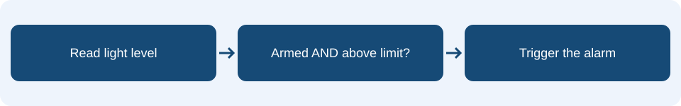

# Lesson 5: Boolean logic and state

## Learning intention & success criteria

**Learning intention:** Use true/false values to record state and combine checks with AND.

By the end of this lesson, you should be able to:

- Explain what armed and triggered each remember.
- Predict all four combinations of two AND checks.
- Use measured light readings to choose and test a threshold.

Read one page at a time. Predict before checking the explanations. Your practical tasks are in your workbook.

## The idea in everyday life

Think of an alarm that can be switched on or off. Opening a box should trigger it only while it is armed. The program must remember both whether it is armed and whether it has already detected a problem.

## Remember a true or false state

A Boolean value is either true or false. Use armed to remember whether monitoring is enabled, and triggered to remember whether the alarm has detected light. These variables describe different things. On start, set both to false. Button A clears triggered before setting armed to true; button B sets both false and clears the display.

<aside class="word-note" markdown="1">
**Key word: Boolean**

A value that is either true or false.
</aside>

## Combine checks with AND

The condition armed AND light level > threshold needs both parts to be true. Bright light while disarmed must not trigger the alarm. An armed board in darkness must not trigger it either. First measure covered and uncovered readings, then choose a threshold between them. The right threshold depends on your classroom and covering.

<aside class="word-note" markdown="1">
**Key word: AND**

True only when both combined checks are true.
</aside>

## Remember an earlier event

When the trigger condition is true, set triggered to true. The next check flashes the display while armed AND triggered. Covering the board again makes the light check false but does not set triggered back to false. This remembered state lets the alarm report an opening even after the box closes. NOT reverses a Boolean result: NOT false is true.

<aside class="word-note" markdown="1">
**Key word: State**

Stored information about the current situation of a program.
</aside>

## Follow it on the micro:bit



Set armed and triggered to false at startup. Button A clears triggered then sets armed to true. Button B sets both to false and clears the display. Once triggered is true, covering the display does not reset it.

## Example explained

This is **pseudocode** describing the MakeCode Blocks. Rebuild it using blocks; it is not code to paste into the editor. Any setup or surrounding events described on the previous pages are also needed.

<div class="example-layout" markdown="1">
<div markdown="1">

### Example structure

```text
forever:
    if armed AND light level > threshold:
        set triggered to true
    if armed AND triggered:
        show cross
        pause 200 ms
        clear screen
        pause 200 ms
```

</div>
<div class="code-reading" markdown="1">

### Reading the instructions

**if armed AND light level > threshold**

Checks that monitoring is enabled and the reading is above the chosen limit.

**set triggered to true**

Remembers the detection, even if the light level later falls.

**if armed AND triggered**

Allows flashing only when both states are true.

**show cross / clear screen, with pauses**

Alternates the warning and a blank display so the warning flashes.

</div>
</div>

### What should happen?

With armed false, bright light produces no trigger. Arm the board in darkness, then expose it to light: triggered becomes true and flashing begins. Cover it again: flashing continues. B disarms and clears the alarm.

<aside class="word-note" markdown="1">
**Watch out**

Do not add an else that sets triggered to false whenever the reading drops. That would forget the opening as soon as the box closes. Reset it deliberately in the button handlers.
</aside>

## Predict, trace and check

Will the alarm trigger when armed is false? Why does it keep flashing after the light drops?

Explain your prediction before trying the program. Follow the event one instruction at a time, keeping track of any stored values.

<details markdown="1">
<summary>Check your reasoning</summary>

A disarmed alarm cannot pass the AND check. Flashing continues after the light drops because triggered remembers the earlier detection until reset.

</details>

## What to remember

<p class="main-idea">A sensor tells you what is happening now. State can remember what happened earlier.</p>

### Can you explain it?

- I can explain what armed and triggered each remember.
- I can predict all four combinations of two AND checks.
- I can use measured light readings to choose and test a threshold.

Return to the example if you cannot yet explain one of these points. Use the key words to explain what the blocks do, rather than only describing where to click.

## Apply it in your workbook

Measure covered and uncovered light readings. Choose a threshold between them, then build and test the armed alarm.

**Evidence and explanation:** Record your threshold, a test while disarmed, a trigger test and a stop test. Explain what each Boolean variable records.

Complete **Tasks 5.1, 5.2 and 5.3** in the [Google Docs pupil workbook](https://docs.google.com/document/d/1TtgnkWvogK3TJ2bSEFirT5LDdON6QLlhlYuBmnWRdAc/edit?usp=drivesdk){ target="_blank" rel="noopener noreferrer" }. Use the lesson heading to find your tasks.

### Practical references

These guides retain their original project numbers; those numbers are not the new teaching lesson numbers. Use the relevant tasks described below.

- [Use the alarm build instructions and test table.](../04-treasure-alarm.md)

[Back to the teaching sequence](index.md)
