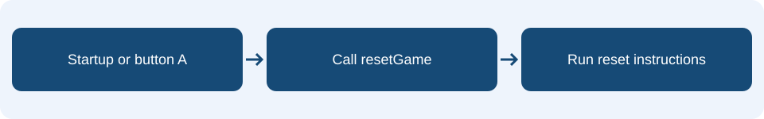

# Lesson 7: Functions

**Learning intention:** Define a named group of instructions, call it and explain why reuse is useful.

## Understand the concept

A function groups instructions under a name. Defining it specifies what it does. Calling it runs those instructions. The same function can be called from different places.

## Connect it to the micro:bit



Continue the tilt project. Put the reset instructions in one function and call it at startup and from button A. If both places need the same reset behaviour, you only need to edit the function once.

## Read the example

This is **pseudocode** showing the order and structure of the MakeCode Blocks. It is not code to paste into the editor.

```text
function resetGame:
    set x to 2
    set score to 0
    clear screen
on start:
    call resetGame
on button A pressed:
    call resetGame
```

## Predict and discuss

Does defining resetGame run it? Where is it called? What changes at both call sites if you add an instruction inside it?

## Apply it in your workbook

Create resetGame, move your reset instructions inside it and call it from startup and button A. Use a name that describes its purpose.

**Evidence and explanation:** Show the function and its two calls. Explain the difference between defining and calling it.

Complete **Tasks 7.1, 7.2 and 7.3** in the [Google Docs pupil workbook](https://docs.google.com/document/d/1TtgnkWvogK3TJ2bSEFirT5LDdON6QLlhlYuBmnWRdAc/edit?usp=drivesdk){ target="_blank" rel="noopener noreferrer" }. Use the lesson heading to find your tasks.

## Practical references

These guides retain their original project numbers; those numbers are not the new teaching lesson numbers. Use the relevant tasks described below.

- [Use the resetGame example; extend the reset instructions if you add the target and score.](../05-tilt-arcade.md)
- [Later reuse: showReady is another named group of instructions.](../10-classroom-help-test.md)

!!! tip "Focus on this lesson"
    Follow the instructions for any supplied blocks. You only need to explain the concepts in this lesson; extra spaces and labels in supplied function blocks are not additional vocabulary to learn.

[Back to the teaching sequence](index.md)
