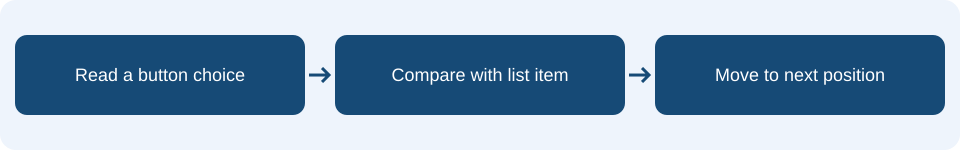

# Lesson 8: Lists and indexing

## Learning intention & success criteria

**Learning intention:** Read values from an ordered list using their positions.

By the end of this lesson, you should be able to:

- Distinguish an item’s value from its index.
- Trace position through a correct sequence.
- Explain why the completion check uses list length.

Read one page at a time. Predict before checking the explanations. Your practical tasks are in your workbook.

## The idea in everyday life

Imagine a playlist. It stores several items in an order, and the same song could appear more than once. A list lets a program store an ordered collection rather than giving every item a separate variable.

## Values and positions are different

The memory game uses 0 for button A and 1 for button B. The list [0, 1, 0] means A, B, A. An index identifies an item’s position, starting at 0. The item at index 0 is 0; the item at index 1 is 1; the item at index 2 is 0. The index and the stored value answer different questions.

<aside class="word-note" markdown="1">
**Key word: List**

An ordered collection of values.
</aside>

## Track the next expected answer

Set position to 0 at the start of checking. Read sequence[position] to find the next expected choice. Compare the player’s choice with that value. Only a correct choice advances position by 1. The supplied framework handles wrong answers and uses accepting to control when button presses count.

<aside class="word-note" markdown="1">
**Key word: Index**

The position of an item, starting at 0.
</aside>

## Length is a count, not a final index

A three-item list has length 3 and valid indexes 0, 1 and 2. After the third correct answer, position becomes 3, meaning all items have been matched. Stop accepting answers before trying to read another item. Comparing position with list length also works when the sequence grows to four items; a fixed check for 3 would finish too soon.

<aside class="word-note" markdown="1">
**Key word: Length**

The number of items in a list.
</aside>

## Follow it on the micro:bit



Use the supplied memory-game framework to play and check a sequence. Here 0 represents A and 1 represents B. The example is the correct-answer part of the checker; the framework also handles wrong answers and playback.

## Example explained

This is **pseudocode** describing the MakeCode Blocks. Rebuild it using blocks; it is not code to paste into the editor. Any setup or surrounding events described on the previous pages are also needed.

<div class="example-layout" markdown="1">
<div markdown="1">

### Example structure

```text
set sequence to [0, 1, 0]
set position to 0
if choice = sequence[position]:
    change position by 1
    if position = length of sequence:
        set accepting to false
        show tick
```

</div>
<div class="code-reading" markdown="1">

### Reading the instructions

**sequence = [0, 1, 0]; position = 0**

Creates the example sequence and starts at its first item.

**choice = sequence[position]**

Checks the player’s choice against the expected item.

**change position by 1**

Advances only after a correct match.

**position = length of sequence**

Detects completion; accepting becomes false and a tick appears.

</div>
</div>

### What should happen?

For A, B, A, the correct choices move position from 0 to 1, then 2, then 3. At 3, the sequence is complete and a tick appears. This excerpt is the correct-answer path, not the entire game.

<aside class="word-note" markdown="1">
**Watch out**

Do not read index 3 from a three-item list. It is outside the valid range. Check completion after advancing and stop the checker before reading the next item.
</aside>

## Predict, trace and check

What is stored at index 1 in [0, 1, 0]? For a list of four items, what are the valid indexes?

Explain your prediction before trying the program. Follow the event one instruction at a time, keeping track of any stored values.

<details markdown="1">
<summary>Check your reasoning</summary>

Index 1 contains 1, meaning B. A four-item list has indexes 0, 1, 2 and 3. Its length is 4.

</details>

## What to remember

<p class="main-idea">Indexes start at 0. Length counts how many items there are.</p>

### Can you explain it?

- I can distinguish an item’s value from its index.
- I can trace position through a correct sequence.
- I can explain why the completion check uses list length.

Return to the example if you cannot yet explain one of these points. Use the key words to explain what the blocks do, rather than only describing where to click.

## Apply it in your workbook

Complete the checker using the supplied framework. In the A event, use the supplied checkChoice call with 0 in its space; in B, put 1 in its space. Keep those supplied blocks and focus on the list and its positions.

**Evidence and explanation:** Record tests for both sequence lengths. Explain why checking list length works better than always checking for 3.

Complete **Tasks 8.1, 8.2 and 8.3** in the [Google Docs pupil workbook](https://docs.google.com/document/d/1TtgnkWvogK3TJ2bSEFirT5LDdON6QLlhlYuBmnWRdAc/edit?usp=drivesdk){ target="_blank" rel="noopener noreferrer" }. Use the lesson heading to find your tasks.

### Practical references

These guides retain their original project numbers; those numbers are not the new teaching lesson numbers. Use the relevant tasks described below.

- [Use the list setup, checking instructions and test table.](../06-memory-master.md)

!!! tip "Focus on this lesson"
    Follow the instructions for any supplied blocks. You only need to explain the concepts in this lesson; extra spaces and labels in supplied function blocks are not additional vocabulary to learn.

[Back to the teaching sequence](index.md)
