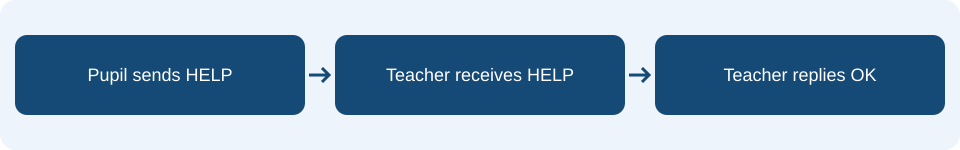

# Lesson 9: Radio communication

**Learning intention:** Send and receive agreed messages between two micro:bits.

## Understand the concept

Radio lets micro:bits exchange messages. Both programs need the same allocated radio group and must agree what each message means. A receive event starts when a message arrives.

## Connect it to the micro:bit



Pupil A sends HELP. Teacher B sends OK. The pupil displays a tick when OK arrives. Text must match exactly, including capitals. The counter records requests, not different pupils.

## Read the example

This is **pseudocode** showing the order and structure of the MakeCode Blocks. It is not code to paste into the editor.

```text
on radio received receivedString:
    if receivedString = "HELP":
        change requests by 1
        show string "H"
```

## Predict and discuss

Which event sends HELP? Which event handles it? Why can two boards with different groups fail to communicate?

## Apply it in your workbook

Build the pupil and teacher help programs. Test the request, acknowledgement and repeated requests. Save them for Lesson 10.

**Evidence and explanation:** Draw the message journey, include both programs and record what happens after repeated A presses.

Complete **Tasks 9.1, 9.2 and 9.3** in the [Google Docs pupil workbook](https://docs.google.com/document/d/1TtgnkWvogK3TJ2bSEFirT5LDdON6QLlhlYuBmnWRdAc/edit?usp=drivesdk){ target="_blank" rel="noopener noreferrer" }. Use the lesson heading to find your tasks.

## Practical references

These guides retain their original project numbers; those numbers are not the new teaching lesson numbers. Use the relevant tasks described below.

- [Use the two-board help-system build and its request counter.](../09-classroom-help.md)
- [Additional reference for sending and receiving HELP and OK.](../07-wireless-rescue.md)

[Back to the teaching sequence](index.md)
