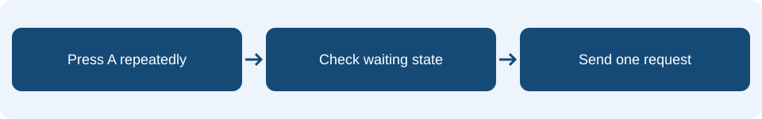

# Lesson 10: Integration, testing and evaluation

## Learning intention & success criteria

**Learning intention:** Combine earlier concepts, prevent duplicate requests and evaluate against requirements.

By the end of this lesson, you should be able to:

- Write a test with an expected and an actual result.
- Trace waiting through a request and its acknowledgement.
- Use test evidence to evaluate a requirement and explain a limitation.

Read one page at a time. Predict before checking the explanations. Your practical tasks are in your workbook.

## The idea in everyday life

Testing a new door lock once is not enough. You would check that the right key opens it, the wrong key does not, and locking it again still works. A program also needs tests for different situations, including actions it should reject.

## Turn a requirement into a test

A requirement states what the system must do. For example: while waiting for a reply, repeated A presses must not send extra requests. A useful test records the starting state, the action, the expected result and the actual result. Write the expected result before running the test so you have something clear to compare.

<aside class="word-note" markdown="1">
**Key word: Requirement**

A statement of what the system must do.
</aside>

## Use state to prevent duplicates

Set waiting to false at startup. In the A event, check NOT waiting. On the first press this is true: set waiting to true before sending HELP. Further presses see waiting true, so NOT waiting is false and no extra request is sent. Receiving OK sets waiting false and allows a new request.

<aside class="word-note" markdown="1">
**Key word: Debugging**

Finding and repairing faults in a program.
</aside>

## Repair, retest and evaluate

Keep the teacher counter so you can observe duplicate requests. If a result differs from the prediction, trace the event and stored values, change the faulty instructions, then repeat that test and related tests. Evaluation explains how well the requirements were met using results. Name a limitation too: without a received reply, this simple pupil program stays waiting; it has no automatic timeout.

<aside class="word-note" markdown="1">
**Key word: Evaluation**

Judging how well requirements were met, using evidence.
</aside>

## Follow it on the micro:bit



Set waiting to false at startup. Setting it true before sending closes the opportunity for another request while waiting. Keep the teacher counter so you can prove that repeated presses do not send duplicates.

## Example explained

This is **pseudocode** describing the MakeCode Blocks. Rebuild it using blocks; it is not code to paste into the editor. Any setup or surrounding events described on the previous pages are also needed.

<div class="example-layout" markdown="1">
<div markdown="1">

### Example structure

```text
on button A pressed:
    if NOT waiting:
        set waiting to true
        radio send string "HELP"
        show question mark
on radio received receivedString:
    if receivedString = "OK":
        set waiting to false
        show tick
```

</div>
<div class="code-reading" markdown="1">

### Reading the instructions

**if NOT waiting**

Allows a request only when the pupil is ready.

**set waiting to true → send "HELP"**

Records the pending request before another press can send one.

**if receivedString = "OK"**

Checks that the incoming message is the acknowledgement.

**set waiting to false → show tick**

Allows another request and displays confirmation.

</div>
</div>

### What should happen?

Start both programs with the teacher count at 0. One A press followed by three more before any reply should leave the count at 1. After teacher B sends OK and the pupil receives it, a new A press should increase the count to 2.

<aside class="word-note" markdown="1">
**Watch out**

Showing a question mark does not remember that a request is pending. The condition must check waiting, and OK must reset waiting. Otherwise duplicates may be allowed, or the pupil may never be able to request help again.
</aside>

## Predict, trace and check

After one request and three more A presses, what should the teacher count show? What must happen before another request is allowed?

Explain your prediction before trying the program. Follow the event one instruction at a time, keeping track of any stored values.

<details markdown="1">
<summary>Check your reasoning</summary>

The teacher count should be 1, assuming that the first HELP arrived once and no other sender contributed. The pupil must receive OK before it can send another request.

</details>

## What to remember

<p class="main-idea">Predict, test, compare, repair and retest. Use the evidence in your evaluation.</p>

### Can you explain it?

- I can write a test with an expected and an actual result.
- I can trace waiting through a request and its acknowledgement.
- I can use test evidence to evaluate a requirement and explain a limitation.

Return to the example if you cannot yet explain one of these points. Use the key words to explain what the blocks do, rather than only describing where to click.

## Apply it in your workbook

Improve the Lesson 9 programs, reuse showReady and run the full test table. Record faults and retests.

**Evidence and explanation:** Include expected and actual results, both final programs, a repair if needed, and an evaluation naming one limitation.

Complete **Tasks 10.1, 10.2 and 10.3** in the [Google Docs pupil workbook](https://docs.google.com/document/d/1TtgnkWvogK3TJ2bSEFirT5LDdON6QLlhlYuBmnWRdAc/edit?usp=drivesdk){ target="_blank" rel="noopener noreferrer" }. Use the lesson heading to find your tasks.

### Practical references

These guides retain their original project numbers; those numbers are not the new teaching lesson numbers. Use the relevant tasks described below.

- [Use the improvement tasks and complete test table.](../10-classroom-help-test.md)

[Back to the teaching sequence](index.md)
